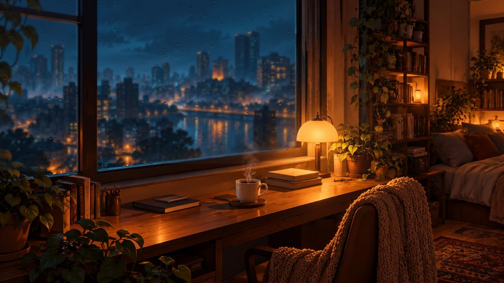
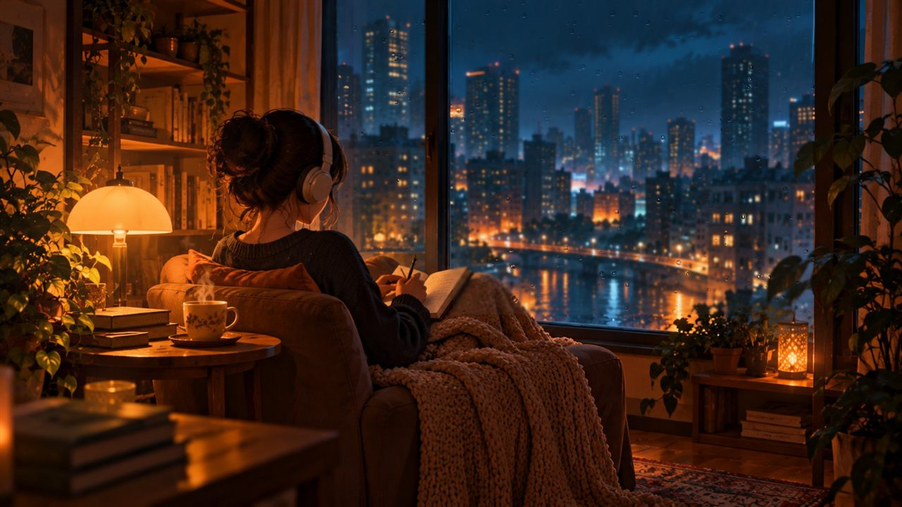
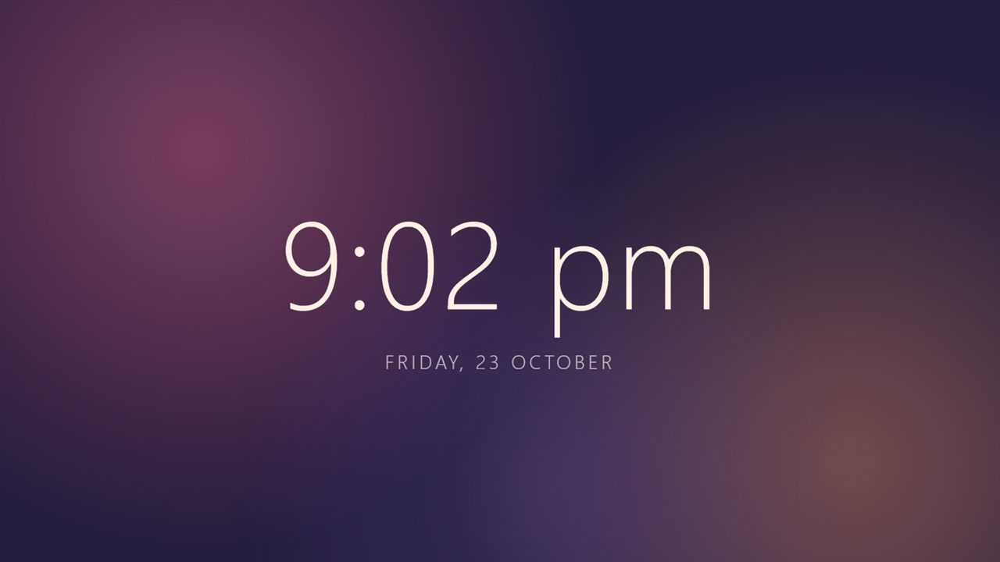

# Elsewhere, Within

**A place to feel.**

Quiet, silent scenes for your Windows screen: a rainy window with a lit lamp, a
late-night study, a calm clock. Each scene is its own entry in Windows Screen
Saver Settings. Nothing is downloaded while it runs, nothing is recorded, and
there is no sound.

> **v0.1 Preview — tested on one Windows 11 PC.** It works there, but it has not
> met your hardware yet. That is exactly why it is public: please try it and
> tell me what happens (see [Feedback](#feedback)).

## Scenes

| | |
|---|---|
|  | **Rainy Window** (Cozy Spaces)<br>A lamp-lit desk and a city in the rain. Raindrops run down the glass, the lamp glows and the cup steams. |
|  | **Study Night** (Cozy Spaces)<br>Someone reading by the window at night, headphones on, rain on the glass. |
|  | **Dashboard Clock** (Dashboard)<br>A large, quiet time and date over slow colour that follows the time of day. It drifts a little every few minutes so nothing burns into the screen. |

Every scene ends gently: when you move the mouse or press a key it fades out
with a soft ring from your cursor (about half a second) and you are back at the
desktop. If you have Windows' "reduce motion" setting on, scenes hold still.

## Install

1. Go to **[Releases](../../releases)** and download `ElsewhereWithin-Setup.exe`.
2. Run it. Windows SmartScreen may say *"Windows protected your PC"* because the
   installer is not code-signed (yet). Click **More info → Run anyway**.
   You can check the download against the SHA-256 shown in the release notes
   (`Get-FileHash ElsewhereWithin-Setup.exe` in PowerShell).
3. Click **Yes**. It installs for your user only and needs no administrator rights.
4. **Screen Saver Settings** opens. Every scene is in the list as
   **"Elsewhere - &lt;scene&gt;"** (for example *Elsewhere - Rainy Window*). Choose one,
   set **Wait** (the idle minutes), and click **OK**. Use **Preview** to see it now.

It needs the Microsoft Edge **WebView2 Runtime**, which comes with Windows 11 and
current Windows 10. If your PC lacks it, the installer offers to install it.

## Live wallpaper (optional, preview)

The installer asks whether to also install **Elsewhere, Within live wallpaper**: the same scenes behind your desktop icons.
It starts from a tray icon, where you can pick the scene, pause it, start it with Windows, or quit (which restores your normal wallpaper).
It pauses itself when an app covers the desktop, on Battery saver and when the screen is locked. In Rainy Window and Study Night you can drag the mouse across the bare desktop to wipe the misted glass.
See [the test checklist](docs/wallpaper-test-checklist.md).

## Uninstall

**Settings → Apps → Installed apps → Elsewhere, Within screensaver → Uninstall.**
This removes the program and its log, and puts the screensaver setting back to
*(None)* if one of our scenes was selected.

## Known limitations

- Only tested on one Windows 11 PC so far. Other Windows 10/11 machines, multiple
  monitors, high-DPI and older graphics are untested.
- With several monitors, the scene plays on the main screen; the others go black.
- The installer is not code-signed, so SmartScreen warns once.
- The small preview in Screen Saver Settings shows only the scene's name, not the animation.
- Scenes are drawn in the browser engine of WebView2; on a very old GPU they may
  stutter. Tell me if they do.
- Windows only. There is no macOS or Linux version.

## Privacy

Runs entirely on your PC. It does not use the microphone, camera or location,
and it blocks all network requests from the scene. A small log is kept at
`%LOCALAPPDATA%\ElsewhereWithin\screensaver.log` (start, errors, why it closed);
it never leaves your machine.

## Feedback

**Please open an [Issue](../../issues/new/choose).** A bug report, "it looked odd
on my monitor", or an idea for a scene are all welcome. For bugs, include your
Windows version, which scene, and what happened.

## Build it yourself

You need Node.js and Windows (the built-in C# compiler is used).

```powershell
npm install
npm run test:library                      # the scene tests
npm run dev:library                       # preview scenes in a browser: ?scene=rainy-window&time=dusk
powershell -ExecutionPolicy Bypass -File screensaver\build.ps1            # one .scr per scene in screensaver\out
powershell -ExecutionPolicy Bypass -File screensaver\build-installer.ps1  # release\ElsewhereWithin-Setup.exe
```

- `library/` — the scenes (`library/scenes/<id>/`) and the small runtime around them.
- `screensaver/` — the Windows host (`ElsewhereWithin.cs`, a small C# window around WebView2), the installer, and build scripts.
- `src/` — the original Elsewhere, Within web experiment: a lake that moves with your breath (it asks for the microphone in a browser). `npm run dev` runs it. It is separate from the screensaver, which never uses the microphone.
- `Screen Saver/` — notes and source art for scenes.

## Credits

- Lake photograph: **Ivan Dimitrov** on [Unsplash](https://unsplash.com/) (used by the original web experiment).
- Illustrations (Rainy Window, Study Night): AI-generated for Elsewhere, Within with ChatGPT; the rain, lamp glow, steam and other motion are drawn in code. The image files carry their original content-credentials (C2PA) metadata.
- Microsoft Edge WebView2 provides the web view (redistributed under Microsoft's terms).

## License

Code: [MIT](LICENSE). Artwork: free to use with Elsewhere, Within, not for resale
or redistribution as standalone art; see [ASSETS-LICENSE.md](ASSETS-LICENSE.md).