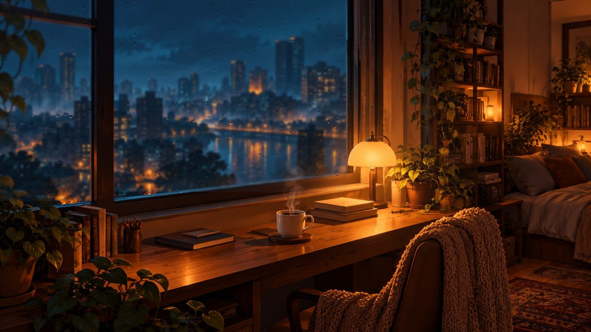
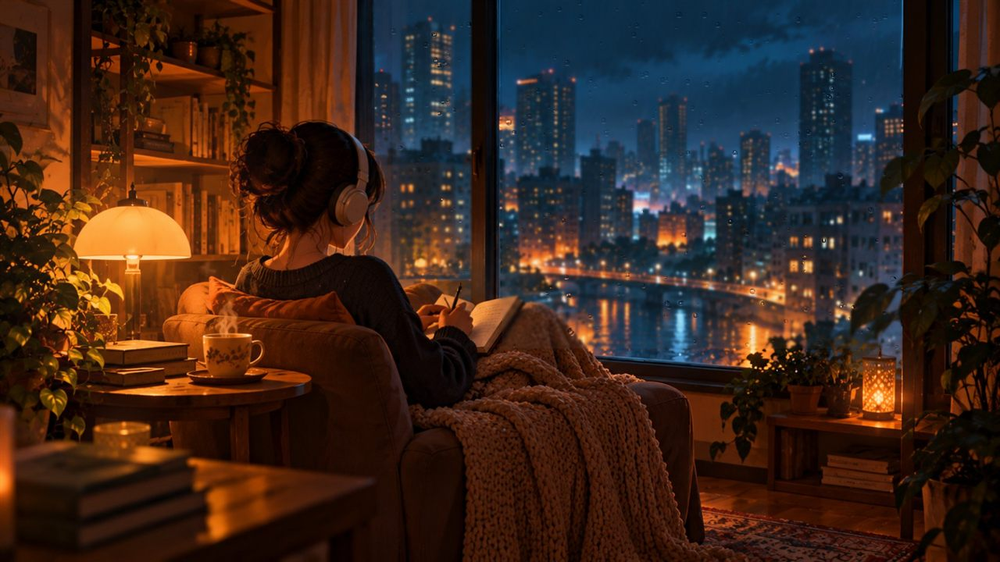
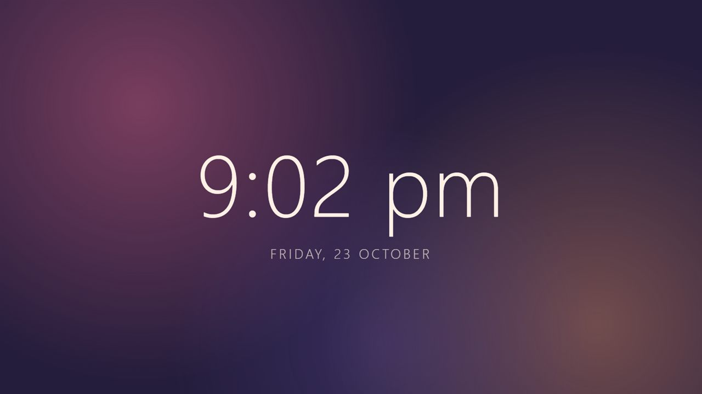

# Elsewhere, Within

**A place to feel.**

Free, silent, offline scenes for your Windows screen: small living worlds that
move on their own, follow your PC clock, and can also play behind your desktop
icons as an interactive live wallpaper. There are 20 scenes so far: a rainy
window, a living pond with paper boats and frogs, a pixel island that builds
itself, a train looping through a painted valley, a detective's desk with a new
coded message every day, and more. Each scene is its own entry in Windows Screen
Saver Settings. No ads, no accounts, no tracking, no sound, and no network
access while a scene runs.

> **v0.x Preview.** The first scenes were tested on two Windows PCs (Windows 11 and a
> two-monitor 22H2 PC). Newer scenes have had less testing, and none of it has met
> your hardware yet. That is exactly why it is public: please try it and
> tell me what happens (see [Feedback](#feedback)).

## Scenes

| | |
|---|---|
|  | **Rainy Window** (Cozy Spaces)<br>A lamp-lit desk and a city in the rain. Raindrops run down the glass, the lamp glows and the cup steams. |
|  | **Study Night** (Cozy Spaces)<br>Someone reading by the window at night, headphones on, rain on the glass. As a wallpaper you can draw in the fogged glass. |
|  | **Dashboard Clock** (Dashboard)<br>A large, quiet time and date over slow colour that follows the time of day. It drifts a little every few minutes so nothing burns into the screen. |

More scenes in the library:

- **Dashboard:** *Cipher Desk* (a detective's desk with a new coded message every day, harder each day; clues arrive through the day and it solves itself at 18:00 with the steps), *Clockmaker's Almanac*
- **Cozy Spaces:** *Houseboat Morning*
- **Dreamscapes & Landscapes:** *Living Pond* (touchable water, paper boats, fish and frogs), *Follow the Light*, *Tea Hills in Morning Mist*, *Cloud Pasture* (a patchwork countryside from above, with sheep and crops that live through their year)
- **Anime & Illustrated Worlds:** *Last Train Platform*, *Lighthouse Cove*, *Ferry at Blue Hour*, *Night Market Alley*, *Sunset Ruins*, *Valley Railway* (a train loops through a painted valley)
- **Pixel Art & Retro Worlds:** *Island Colony* (a tiny island that builds itself), *Hillside Cable Car*, *Lakeside Blocks*
- **Seasons & Special Moments:** *Ginkgo Courtyard* (an autumn courtyard; leaves blow in the wind)

Screenshots for the newer scenes will be added as they are checked on real PCs.

As a screensaver, every scene ends gently: when you move the mouse or press a key it fades out
with a soft ring from your cursor (about half a second) and you are back at the
desktop. If you have Windows' "reduce motion" setting on, scenes hold still.

## Install

1. Go to **[Releases](../../releases)** and download `ElsewhereWithin-Setup.exe`.
2. Run it. Windows SmartScreen may say *"Windows protected your PC"* because the
   installer is not code-signed (yet). Click **More info → Run anyway**.
   You can check the download against the SHA-256 shown in the release notes
   (`Get-FileHash ElsewhereWithin-Setup.exe` in PowerShell).
3. Click **Yes**. It installs for your user only and needs no administrator rights.
4. **Screen Saver Settings** opens. Every scene is in the list as
   **"Elsewhere - &lt;scene&gt;"** (for example *Elsewhere - Rainy Window*). Choose one,
   set **Wait** (the idle minutes), and click **OK**. Use **Preview** to see it now.

It needs the Microsoft Edge **WebView2 Runtime**, which comes with Windows 11 and
current Windows 10. If your PC lacks it, the installer offers to install it.

## Live wallpaper (optional, preview)

The same scenes can also play **behind your desktop icons** as a live wallpaper
(`ElsewhereWallpaper.exe`). It is optional and separate from the screensaver.

- **Turn it on:** when you run the installer, answer **Yes** to "Also install the live wallpaper?"
  It starts straight away. Later, start it from **Start menu → Elsewhere, Within live wallpaper**.
- **Control it:** it lives in the tray, near the clock (under the ^ arrow). Right-click the icon to pick the
  scene, **Pause/Resume**, tick **Start with Windows**, or **Quit**.
- **Turn it off:** **Quit** from the tray menu puts your normal wallpaper back at once. Untick
  **Start with Windows** so it does not come back at sign-in. Uninstalling removes it entirely.
- **It stays out of the way:** it **pauses by itself** (no drawing, almost no CPU) while a **full-screen or
  maximised app** covers the desktop, on **Battery saver**, and while the screen is **locked**. It draws
  at 30 frames a second at most.
- **Mouse:** icons, the taskbar and your windows behave exactly as usual. On the bare desktop the mouse
  talks to the scene: in Rainy Window and Study Night, drag across the glass to wipe the mist. Because of
  that, a left-drag on the bare desktop does not draw the usual selection rectangle while the wallpaper
  runs; **Pause** it from the tray when you want that.
- **Hand control (optional, off by default):** tick **Hand control (camera)** in the tray menu and some scenes
  (for example Ginkgo Courtyard and Cloud Pasture) react to you waving at your webcam. Only motion blocks reach the
  scene; nothing is recorded, saved or sent. It works on the main monitor only, and the camera closes whenever the
  scene is paused. This is a preview feature and has had little testing.
- It needs Windows 10 or 11 with the WebView2 Runtime, and has been tested on two Windows PCs.
  See [the test checklist](docs/wallpaper-test-checklist.md).
## Uninstall

**Settings → Apps → Installed apps → Elsewhere, Within screensaver → Uninstall.**
This removes the program and its log, and puts the screensaver setting back to
*(None)* if one of our scenes was selected.

## Known limitations

- Only tested on two Windows PCs so far. Other Windows 10/11 machines, multiple
  monitors, high-DPI and older graphics are untested.
- With several monitors, the scene plays on the main screen; the others go black.
- The installer is not code-signed, so SmartScreen warns once. The updater trusts GitHub plus the checksum published next to each release; it cannot prove who built a release.
- The small preview in Screen Saver Settings shows only the scene's name, not the animation.
- Scenes are drawn in the browser engine of WebView2; on a very old GPU they may
  stutter. Tell me if they do.
- Windows only. There is no macOS or Linux version.

## Privacy

The scenes run entirely on your PC: they do not use the microphone or location, and
all network requests from a scene are blocked. The camera is used only if you switch on
**Hand control (camera)** in the live wallpaper's tray menu (off by default, wallpaper only,
never the screensaver); frames are reduced to small grey images in memory to detect motion
and are never stored or sent.

**The only part that goes online is the updater** (`ElsewhereUpdate.exe`). Once a day and at
sign-in it asks `api.github.com` for this project's latest release. If a newer one exists it
downloads the installer and `SHA256SUMS.txt` from GitHub, checks the checksum, and installs it
quietly. It never runs while a screensaver is active, and it sends nothing about you beyond what
any web request carries (your IP address, and a user agent like `ElsewhereWithin-Updater/0.1.0`).
Switch it off in **Screen Saver Settings → Settings → "Check for updates automatically"**; its
log is `%LOCALAPPDATA%\ElsewhereWithin\update.log`. Uninstalling removes its scheduled task.

A small log of the screensaver (start, errors, why it closed) is kept at
`%LOCALAPPDATA%\ElsewhereWithin\screensaver.log`; it never leaves your machine.
## Feedback

**Please open an [Issue](../../issues/new/choose).** A bug report, "it looked odd
on my monitor", or an idea for a scene are all welcome. For bugs, include your
Windows version, which scene, and what happened.

## Releases

The version lives in one place: "version" in package.json. To publish: bump it, commit, then push a tag with the same number (`git tag v0.1.1 && git push origin v0.1.1`). GitHub Actions runs the tests, builds the installer and creates the pre-release with SHA256SUMS.txt.

## Build it yourself

You need Node.js and Windows (the built-in C# compiler is used).

```powershell
npm install
npm run test:library                      # the scene tests
npm run dev:library                       # preview scenes in a browser: ?scene=rainy-window&time=dusk
powershell -ExecutionPolicy Bypass -File screensaver\build.ps1            # one .scr per scene in screensaver\out
powershell -ExecutionPolicy Bypass -File screensaver\build-installer.ps1  # release\ElsewhereWithin-Setup.exe
```

- `library/` — the scenes (`library/scenes/<id>/`) and the small runtime around them.
- `screensaver/` — the Windows host (`ElsewhereWithin.cs`, a small C# window around WebView2), the installer, and build scripts.
- `src/` — the original Elsewhere, Within web experiment: a lake that moves with your breath (it asks for the microphone in a browser). `npm run dev` runs it. It is separate from the screensaver, which never uses the microphone.
- `Screen Saver/` — notes and source art for scenes.

## Credits

- Lake photograph: **Ivan Dimitrov** on [Unsplash](https://unsplash.com/) (used by the original web experiment).
- Illustrations: AI-generated for Elsewhere, Within (ChatGPT and other AI image tools, some upscaled with Real-ESRGAN); the rain, lamp glow, steam and other motion are drawn in code. Some scenes (such as Living Pond and Cipher Desk) are drawn fully in code. The image files carry their original content-credentials (C2PA) metadata.
- Microsoft Edge WebView2 provides the web view (redistributed under Microsoft's terms).

## License

Code: [MIT](LICENSE). Artwork: free to use with Elsewhere, Within, not for resale
or redistribution as standalone art; see [ASSETS-LICENSE.md](ASSETS-LICENSE.md).